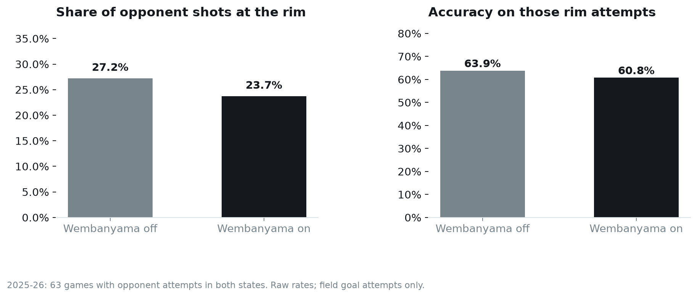
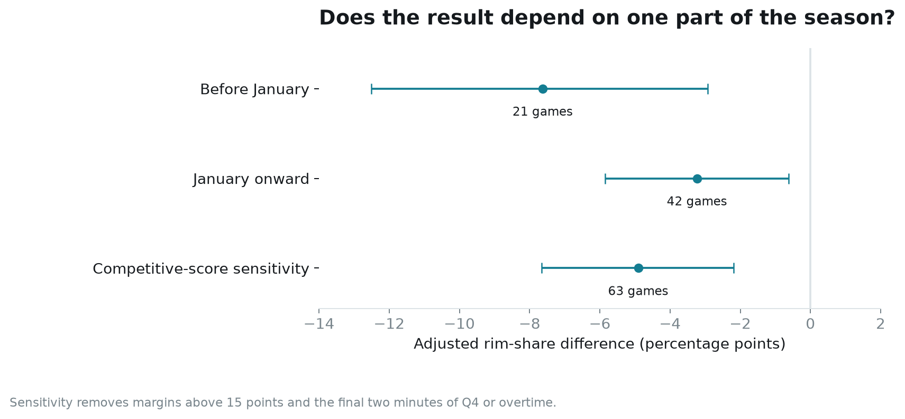

# Where Wembanyama changes the shot map

Joseph Smarrelli · September 2026 · 2025–26 regular-season study

Opponents took a smaller share of their shots at the rim during Victor Wembanyama’s minutes. That difference survives a comparison within the same games, adjustment for score and clock, and a check that removes large margins and late-game situations. The corresponding difference in finishing at the rim is much less certain.

That distinction matters for a coaching question: should a film review begin with the shots Wembanyama contests, or with the possessions that end somewhere else?

## Build the comparison before counting the shots

I reconstructed San Antonio’s five players from substitutions and player appearances in the public NBA play-by-play archive. Each retained period had to resolve five starters, every substitution, active player identities and its full clock. I then matched attempts to the shot-location feed by game and event.

The audit retained 325 of 330 periods and 14,642 of 14,840 field goal attempts across Spurs games, or 98.7%. One period did not identify five starters. A separate game was excluded because the two feeds named different shooters for the same event. These are reconstructed lineups, without an independent reconciliation to official box-score minutes. The exclusions are available in the audit tables.

The on/off comparison then uses only games with opponent attempts in both states: 63 games and 5,726 attempts. “At the rim” means the source’s Restricted Area classification. An attempt remains in the denominator whether it was made or missed.

Opponents took 27.2% of their attempts at the rim with Wembanyama off and 23.7% with him on. They made 63.9% and 60.8% of those rim attempts, respectively. These raw splits describe the sample; substitutions also change teammates, opponents and game situations.

## Compare minutes within the same game

The primary model estimates rim-attempt probability with a game fixed effect. It adjusts for score margin, squared margin, period, remaining period time and the shooter’s prior-season rim-attempt share. That last variable is smoothed toward the league rate, so a small prior sample does not receive undue weight. No current-season shooter outcome enters that prior.

The estimated on-minus-off difference is **−4.6 percentage points**, with a 95% game-bootstrap interval from **−7.0 to −2.3**. The model with game effects alone estimates −4.3 points.

For finishing, I fit the same form of model using only rim attempts. Its adjusted difference is **−0.7 percentage points**, with an interval from **−5.7 to +4.2**. That is compatible with meaningfully lower finishing, little change or some increase. The raw finishing split is therefore a weak basis for assigning an individual defensive value.

The field-goal scoring difference is −8.1 points per 100 attempts after adjustment. This is a shot-based measure. It excludes free throws and does not account for possessions ending in turnovers, so it should not be presented as defensive rating.

## Does the pattern survive narrower samples?

The adjusted rim-share difference is −7.6 percentage points before January and −3.2 points from January onward. Both intervals remain below zero. Removing score margins above 15 points and the final two minutes of the fourth quarter or overtime gives a −4.9-point estimate.

These checks make it harder to attribute the entire association to one stretch of the season or to late-game score effects. They do not establish what would happen if the coaching staff changed Wembanyama’s minutes. Opponent personnel, coverage and substitution choices still vary within games.

## What I would bring to a film session

Start with opponent possessions that reach the paint but produce a pass, retreat or pull-up. Tag the initial advantage, Wembanyama’s location, the low defender’s responsibility and the final shot. Compare the same opponent’s actions with him off the floor. Include attacks that draw fouls or end in turnovers, which this shot-only dataset misses.

A second pass should distinguish planned coverage from a shooter reacting to Wembanyama. Shot coordinates cannot tell those apart. Nor can they identify the primary defender or measure the distance of a contest.

The current evidence supports a review priority: investigate how his minutes change access to the restricted area. It is insufficient to attach a causal points-saved estimate to him or to prescribe a different substitution pattern.

## Data and reproducibility

Source: public NBA shot locations and play-by-play preserved in the [nba_data archive](https://github.com/shufinskiy/nba_data/tree/e829d4678be1e075f99e5d41a1c5f97089be446b). Regular-season inputs are pinned to that revision and verified by checksum. The repository includes the reconstruction audit, model rows, uncertainty calculations, SQL summaries and an executed notebook. Primary intervals use 2,000 game resamples; sensitivity intervals use 1,000. All results are retrospective public-data research.
