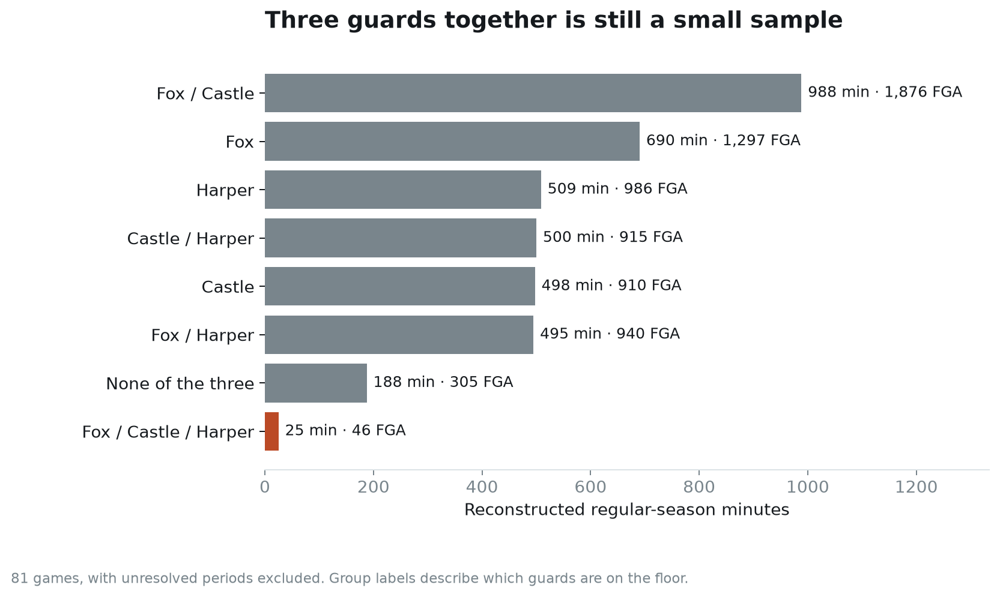
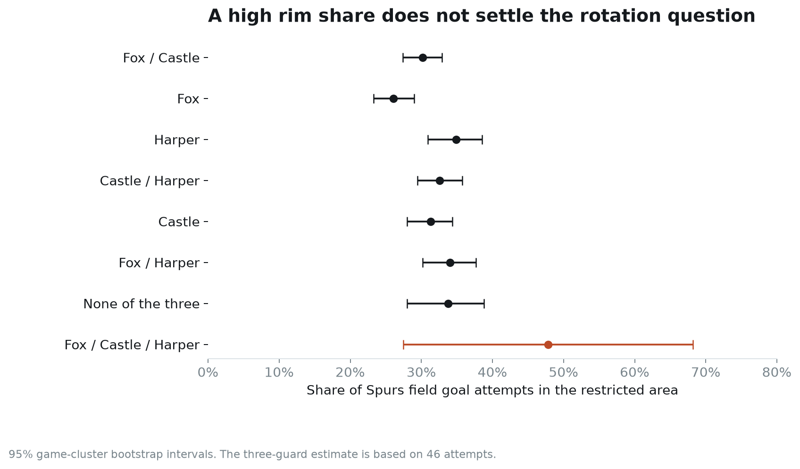
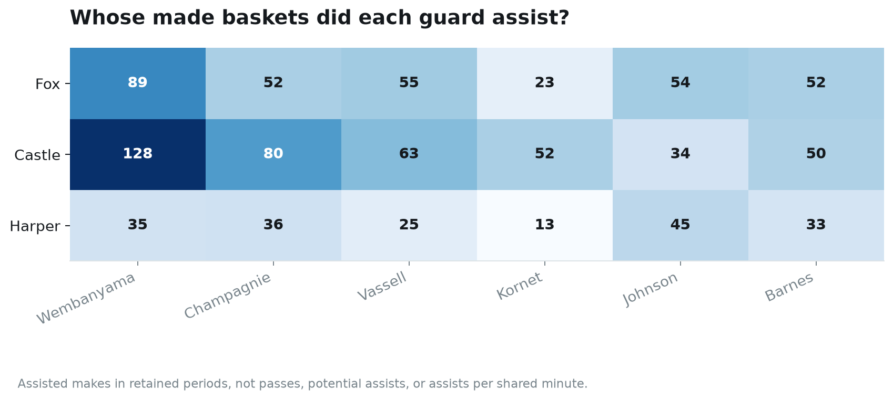

# Three guards, eight groups, one small sample

Joseph Smarrelli · September 2026 · 2025–26 Spurs rotation study

The Fox–Castle–Harper group reached the restricted area on 22 of 46 field goal attempts in the reconstructed regular-season sample. A 47.8% rim share sounds like an answer to the three-guard debate. It is a useful starting point for reviewing possessions, but the uncertainty is too large to recommend expanding the group’s minutes from that number alone.

The underlying question is practical: how do De’Aaron Fox, Stephon Castle and Dylan Harper fit together, and which combinations deserve a closer look? Mitch Johnson discussed [playing the three guards together](https://www.nba.com/news/q-a-spurs-coach-mitch-johnson) during the season. This study turns that question into a repeatable rotation report.

## Eight mutually exclusive groups

Each retained event belongs to one of eight combinations: none of the three, one guard alone, one of the three pairs, or all three. “Fox” means Fox is on the floor while Castle and Harper are off. Other teammates can change inside any group, so these are guard combinations rather than fixed five-man lineups.

The reconstruction covers 3,893 minutes and 7,275 Spurs attempts across 81 games, with unresolved periods excluded. The NBA Cup final and playoffs are outside this regular-season sample. Starting players, substitutions and clocks must reconcile before a period is used. One additional game is removed because the play-by-play and shot feed disagree on a shooter.

Fox and Castle together account for about 988 minutes and 1,876 attempts. All three guards together account for about 25 minutes spread across 13 games. Treating those two samples as equally informative would badly distort the comparison.

## A large estimate with a wide interval

The three-guard group’s rim share has a 95% game-bootstrap interval of **27.4% to 68.2%**. That range overlaps the estimates for the more frequently used groups. Its field-goal production is 0.98 points per attempt, with an interval of 0.60 to 1.30. Neither measure includes free throws or turnovers.

The other groups offer more observations but still do not isolate the guards’ effects. Wembanyama was on the floor for 66.5% of the Fox–Castle group’s attempts, versus 35.8% for Castle–Harper and 30.4% for the three-guard group. Opponents and other Spurs teammates also differ. Those imbalances are reasons to inspect the accompanying Wembanyama splits before comparing raw scoring rates.

A smoothed estimate tempers the tiny three-guard sample. Adding a prior equal to 100 attempts at San Antonio’s early-season rim rate moves its full-sample estimate from 47.8% to 36.4%. The prior strength is specified in advance, not selected to make the result look favorable. That estimate is a stabilizer, not a correction for lineup selection.

## Does the grouping help predict later shot location?

I fit rim-share forecasts using games before January 1, then evaluated attempts from January onward. Each group’s early rate is smoothed toward the early team rate with the same 100-attempt prior. An unseen group receives the team forecast. The three-guard group had no attempts in the early regular-season sample, so its later results cannot be used to initialize its forecast.

Across 4,350 later attempts, group forecasts have log loss of **0.62244**, compared with **0.62175** for the simpler team forecast. Lower is better. The paired difference is +0.00069, with a game-bootstrap interval of −0.00192 to +0.00329.

There is no demonstrated predictive gain from this grouping in that split. It can still organize film and describe personnel usage, but the validation does not justify treating a group-specific rim rate as a reliable forecast of the next possession.

## Who finishes the guards’ assisted baskets?

The play-by-play credits Castle with 128 assisted makes to Wembanyama in retained periods, Fox with 89 and Harper with 35. These are counts of made baskets, not passes, potential assists or assists per shared minute. Different playing time and teammate availability prevent a clean comparison of passing ability.

The table is more useful as a guide to possessions worth watching. For Wembanyama finishes, distinguish rolls, seals, cuts and transition. For perimeter recipients, identify whether the assist follows a paint touch, a relocation or a simple reversal. The public event descriptions cannot reliably supply those tags.

## The next rotation review

The repository includes a queue of three recorded shots from each guard combination, with game, event, clock and lineup identifiers. They are the earliest examples in each group, not a representative sample or completed film analysis. The queue is a starting point for locating possessions.

For a decision about additional three-guard minutes, extend the review to every such possession, including defensive outcomes, turnovers and free throws. Record spacing responsibilities and who initiates the action. Compare similar opponents and Wembanyama availability before using the larger two-guard samples as benchmarks. The small sample argues for measured evaluation rather than a strong ranking.

## Data and reproducibility

Source: the [pinned NBA public-data archive](https://github.com/shufinskiy/nba_data/tree/e829d4678be1e075f99e5d41a1c5f97089be446b). The repository contains substitution audits, mutually exclusive group totals, SQL stint construction, a chronological validation and an executed notebook. Intervals on the main charts use 2,000 game resamples. Results describe reconstructed public records and are not an official Spurs lineup report.
