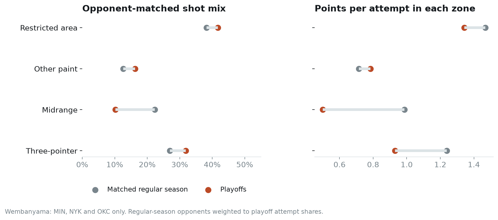
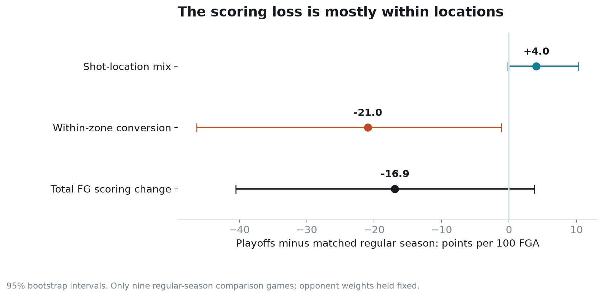
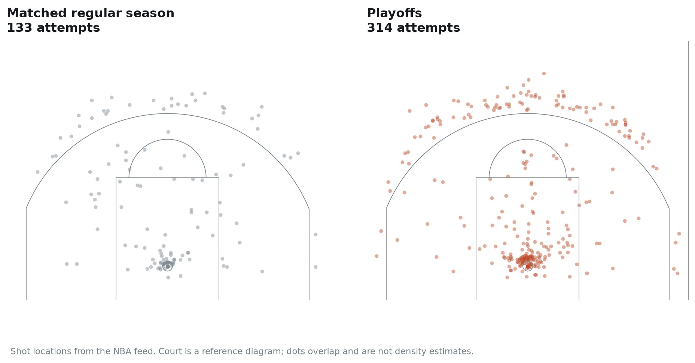

# Did Wembanyama need a different playoff shot diet?

Joseph Smarrelli · September 2026 · 2026 playoff review

Against opponents with a regular-season comparison sample, Victor Wembanyama took a larger share of his playoff attempts at the rim and from three, and fewer from midrange. His field-goal scoring still fell. The accounting points toward lower conversion within locations as the larger contributor in this sample.

That makes the first review question more specific than “Should he shoot fewer threes?” It asks what changed about the attempts inside each part of the floor.

## Match the opponents before comparing the seasons

A playoff schedule is concentrated in a few opponents. Comparing the entire regular season with the playoffs can mix a change in Wembanyama’s game with a change in whom he faced.

I restricted the comparison to Minnesota, New York and Oklahoma City, then weighted regular-season opponents to match their share of his playoff attempts. Portland is excluded because the archive contains no Wembanyama regular-season attempts against Portland that season. Assigning a zero scoring baseline to that missing matchup would create a false result.

That removes 48 playoff attempts. One more attempt is excluded because its zone label conflicts with its two- or three-point value. The final comparison contains **133 regular-season attempts in nine games** and **314 playoff attempts in 18 games**, through June 13, 2026. It is narrower than his full playoff run.

After opponent weighting, his restricted-area share rises from **38.2% to 41.7%**. Three-pointers rise from **26.9% to 31.8%**. Midrange falls from **22.3% to 10.2%**. Other paint attempts rise from 12.6% to 16.2%.

The larger regular-season context also matters. His three-point attempt share was 33.2% in 2023–24, 47.0% in 2024–25 and 32.4% in 2025–26. The matched playoff comparison asks a different question from that full-season trend; its percentages should not be substituted for his season totals.

## Separate location mix from conversion

For each of four zones, scoring per attempt equals attempt share multiplied by points per attempt within that zone. I split the overall change into two components using the average of the regular-season and playoff rates as the reference. This symmetric calculation avoids making either phase the sole baseline.

The weighted regular-season sample produces **1.204 field-goal points per attempt**, compared with **1.035** in the playoffs. Per 100 attempts, the decomposition is:

| Component | Estimated change | 95% bootstrap interval |
| --- | ---: | ---: |
| Shot-location mix | +4.0 points | −0.2 to +10.3 |
| Within-zone conversion | −21.0 points | −46.3 to −1.1 |
| Total field-goal scoring | −16.9 points | −40.5 to +3.7 |

The two components sum to the total before rounding. A different location mix would have been associated with slightly higher production at the average zone rates. Lower production within zones accounts for the observed decline in the point estimate.

That accounting is not proof of an underlying decline in shooting ability. “Within-zone conversion” includes contests, shot creation, movement, fatigue, shot-clock pressure and ordinary make-or-miss variation. A restricted-area label covers several kinds of finishes; a three-point label does not distinguish an open catch from a difficult pull-up.

The interval for total change crosses zero. There are only two regular-season games each against Minnesota and New York, and five against Oklahoma City. Resampling those games cannot represent every form of uncertainty about a playoff matchup. The intervals hold the observed playoff-opponent weights fixed and should be read as conditional estimates from a sparse baseline.

## Use the map to narrow the film request

The map shows recorded attempts, with overlap near the rim. The playoff panel has more than twice as many observations, so visual density alone cannot establish a shift in preference. The weighted shares above provide that comparison.

For the next review, tag rim attempts by entry type, catch location and help timing. Separate clean catches from catches that require a reset before the finish. For threes, tag catch-and-shoot versus pull-up, the preceding action, contest distance and time remaining. Those fields would help distinguish a location issue from a shot-quality issue inside a location.

A useful follow-up would model make probability with those possession details, validate it on games outside the fitting sample, and compare expected with actual field-goal points. This project does not label coordinate-only estimates as expected shot quality, and it does not claim that film has already been coded.

## Decision boundary

The observed shot mix supplies little support for a blanket instruction to move away from threes. The larger arithmetic contribution lies within zones. That supports reviewing the conditions of his attempts before prescribing a new mix.

The study cannot evaluate the full offensive cost or value of those choices. Free throws, turnovers, offensive rebounds and the effects on teammates are outside its denominator. It also cannot provide a matched Portland estimate without additional information. Those limits belong alongside the result when presenting it to a coach.

## Data and reproducibility

Source: NBA shot locations in the [versioned public archive](https://github.com/shufinskiy/nba_data/tree/e829d4678be1e075f99e5d41a1c5f97089be446b). Inputs are pinned and checksummed. The repository includes opponent weights, exclusion counts, the exact decomposition, 2,000 game-bootstrap draws summarized as intervals, three seasons of context and an executed notebook. This is retrospective research from public data.
